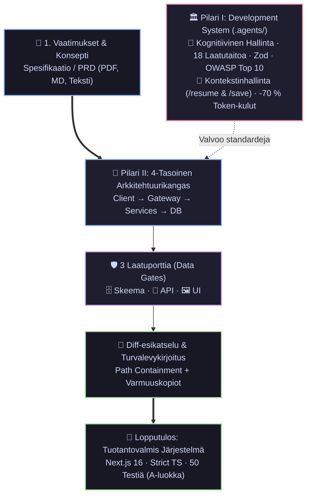

# 🏛️ Agentic Engineering Suite — Strateginen ja Tekninen Järjestelmäkatsaus
## Deterministisen tekoälyagenttituotannon viitekehys, laatuportit ja visuaalinen arkkitehtuurialusta

[](#2-järjestelmäarkkitehtuuri-ja-kaksi-pilaria)
[](#3-tekninen-hallintajärjestelmä-ja-laadunvarmistus)

[](#12-yksikköekonomia-ja-token-optimointi)
[](https://nextjs.org/)

> 🏛️ **Agentic Engineering Suite — Master Specification (Pääteos)**  
> Tämä strateginen järjestelmäkatsaus toimii emo- ja yleiskatsausdokumenttina kahdelle itsenäiselle tekniselle erikoisraportille:  
> • **Osa I (1/2):** *Agentic Fullstack Development System — Insinööristandardit & Kognitiivinen Hallinta*  
> • **Osa II (2/2):** *Agentic Architect — Visuaalinen Kangas & Deterministiset Laatuportit*

---

## Executive Summary: Tekoälyavusteisen ohjelmistokehityksen murrosvaihe

Vuonna 2026 ohjelmistokehityksen suurin pullonkaula ei ole enää koodirivien kirjoittamisen nopeus. Generatiiviset mallit kykenevät tuottamaan toiminnallista syntaksia sekunneissa. 

Ongelmaksi on muodostunut **hallitsematon koodigenerointi ("Vibe Coding")**, joka johtaa suuriin liiketoiminta- ja teknologiakriiseihin:
1. **Arkkitehtuurin mureneminen (Architectural Drift):** LLM-mallit tekevät paikallisia mikropäätöksiä ilman käsitystä koko järjestelmän eheydestä, jolloin syntyy ristiriitaisia rajapintoja ja arkkitehtonista spagettia.
2. **Kontekstin rapautuminen (Context Rot):** Laajojen koodikantojen massasyöttö tekoälylle johtaa hallusinointiin, eksponentiaalisiin API-kustannuksiin ja päättelykyvyn romahtamiseen.
3. **Piilevät tietoturvariskit & IP-vastuut:** Ilman automaattisia rajauksia ja analyysia agentit generoivat haavoittuvia riippuvuuksia, puutteellisia validointeja ja luvattomia tiedostojärjestelmäkutsuja.

**Agentic Engineering Suite** tarjoaa ammattilaistason ratkaisun tähän haasteeseen: **deterministisen, ihmisen valvoman (Human-in-the-Loop) ja arkkitehtuurivetoisen ohjelmistotuotantoputken.** 

Kokonaisuus yhdistää kaksi toisiaan todentavaa tasoa:
* **Pilari I (Metodologia & Moottori):** Kognitiivinen kehityskehys, 18 automatisoitua laatutaitoa ja muistiprotokolla, joka estää kontekstihävikin.
* **Pilari II (Tuote & Visuaalinen Alusta):** Selainpohjainen visuaalinen arkkitehtuurikangas, joka kääntää vaatimusdokumentaation suoraan 4-tasoiseksi järjestelmäksi ja auditoitavaksi lähdekoodiksi kolmen laatuportin läpi.



---

## 1. Strateginen Arvolupaus & Liiketoimintavaikutus

Teknologiajohtajalle (CTO / Head of AI) ja liiketoimintajohdolle (CEO / Managing Director) järjestelmä ratkaisee kolme ydinkysymystä: **toimitusvarmuuden, kustannustehokkuuden ja teknologisen riskienhallinnan.**

### 1.1 Konsultointi- ja Tuotekehitystoiminnan Skaalaus

Digitaalisen tuotekehityksen talous perustuu asiantuntijatuntien tehokkuuteen ja toimitusten ennustettavuuteen. Agentic Engineering Suite muuttaa tuotantofunktiota:

| Strateginen Ulottuvuus          | Perinteinen Ohjelmistokehitys                        | Hallitsematon Tekoäly ("Vibe Coding")        | Agentic Engineering Suite                                         |
| :------------------------------ | :--------------------------------------------------- | :------------------------------------------- | :---------------------------------------------------------------- |
| **Time-to-Prototype**           | 2–4 viikkoa (arkkitehtuurisuunnittelu + pohjakoodi)  | 1–2 päivää (hauras, ei arkkitehtuuria)       | **1–2 tuntia (visuaalinen malli + validoidut rungot)**            |
| **Arkkitehtuurin Koheesio**     | Riippuvainen lead-arkkitehdin jatkuvasta valvonnasta | Satunnainen ja sirpaloitunut                 | **Deterministinen: lukittu `.agents/blueprint/`-sopimuksilla**    |
| **Senior/Junior -vipuvaikutus** | Seniorien aika kuluu pohjakoodin katselmointiin      | Koodikanta murenee juniorien tekoälykäytöllä | **Senioritason standardit pakotettu suoraan agenteille**          |
| **Koodin Omistajuus & IP**      | Täysi omistajuus                                     | Epäselvä lisenssi- ja tietoturvapohja        | **100 % asiakkaan omistama standardikoodi ilman lock-inia**       |
| **Tietoturvan Auditointi**      | Sprinttien lopussa tehtävä erillinen vaihe           | Jää usein kokonaan tekemättä                 | **Shift-Left: automaattinen OWASP-tarkastus jokaisessa syklissä** |

### 1.2 Yksikköekonomia ja Token-optimointi

Tekoälyagenttien suoraviivainen ajaminen tuotantokoodikantoja vasten synnyttää valtavia kustannuksia. Jos jokainen prompti lataa 100k+ tokenia projektikontekstia, kustannukset ja mallin päättelyviiveet karkaavat käsistä.

* **Kohdennettu Tilasiirtoprotokolla (`app-memory`):** Kehityssykli käynnistetään komennolla `/resume`, joka lukee ainoastaan 2–4 kriittistä tilatiedostoa (`SESSION_STATE.md`, `PROJECT_STATUS.md` ja aktiivisen spesifikaation).
* **Mitatut Tulokset:** Token-kulutuksen leikkaus **jopa 70 %** suhteessa naiviin kontekstin lataamiseen.
* **Deterministiset Varajärjestelmät (Graceful Degradation):** Järjestelmä kykenee generoimaan skeemat, rajapinnat ja komponentit sääntöpohjaisilla pohjilla (`smart-templates.ts`) ilman lainkaan ulkoisia tekoälykuluja tai API-viiveitä.

---

## 2. Järjestelmäarkkitehtuuri ja Kaksi Pilaria

Agentic Engineering Suite ei ole joukko satunnaisia prompteja, vaan toisiinsa kytkeytyvä, kaksitasoinen ohjelmistotuotantoympäristö.

```
AGENTIC ENGINEERING SUITE
├── PILARI I: Agentic Fullstack Development System (Kehitysjärjestelmä)
│   ├── .agents/blueprint/      --> Versionhallittu totuuden lähde (PRD, Arkkitehtuuri, Tyyli, Tila)
│   ├── .agents/rules/          --> Sitovat insinöörisäännöt (Zod, API-envelope, WCAG, CORS)
│   └── .agents/skills/         --> 18 erikoistunutta agenttityökalua (UI, API, DB, Sec, Test, CI)
│
└── PILARI II: Agentic Architect (Tuotealusta & Visuaalinen Kangas)
    ├── Interactive Canvas      --> 4-tasoinen graafimallinnus (xyflow v12, React 19)
    ├── 3x Data Gates           --> Tietomalli (Prisma) -> Rajapinnat (Zod/API) -> UI (Tailwind)
    ├── Path Security Engine    --> Sandboxed FS -kirjoitus, allowlist, varmuuskopiot
    └── Audit Engine            --> Sisäänrakennettu arkkitehtuuri- ja tietoturva-arviointi
```

### 2.1 Pilari I: Kehitysjärjestelmä ja Insinööristandardit
*(Tarkempi dokumentaatio: Executive Report — Pilari I: Kehitysjärjestelmä ja Insinööristandardit)*

Pilari I toimii ohjelmistotuotannon laadunvalvojana ja moottorina:
* **Single Source of Truth (`.agents/blueprint/`):** Kaikki tuotevaatimukset (`PRD.md`), tekniset valinnat (`ARCHITECTURE.md`), värijärjestelmät (`STYLE_GUIDE.md`) ja tietoturvatulokset (`SECURITY_AUDIT.md`) pidetään koodin rinnalla versionhallinnassa. Agentti ei tee arvauksia muistinsa varassa.
* **18 Automatisoitua Työkalua:** Kattaa koko elinkaaren (`/init`, `/onboard`, `/test`, `/debug`, `/security`, `/perf`, `/ci`, `/docs`, `/save`).
* **Shift-Left Security:** Jokainen API-reitti pakottaa Zod-syötevalidoinnin, standardoidun virheenkäsittelykuoren ja parametrisoidut tietokantakyselyt.

### 2.2 Pilari II: Agentic Architect — Visuaalinen Tuotealusta
*(Tarkempi dokumentaatio: Executive Brief — Pilari II: Agentic Architect — Visuaalinen Tuotealusta)*

Pilari II kääntää abstraktit vaatimukset tarkastettavaksi järjestelmäksi ja tuotantokoodiksi:
* **4-Tasoinen Visuaalinen Mallinnus:** Jäsentää sovelluksen automaattisesti kerroksiin: *Asiakas → API-yhdyskäytävä → Palvelut → Data*. Arkkitehtuuria voi muokata reaaliajassa visuaalisesti tai keskustelemalla.
* **Kolme Laatuporttia (Data Gates):**
  1. *Gate 1: Tietomalli* — Relaatiot, indeksit ja Prisma-skeemat.
  2. *Gate 2: Rajapinnat* — Tyypitetyt, Zod-validoidut Next.js Route Handlerit.
  3. *Gate 3: Käyttöliittymä* — Design-tokeneihin sidotut React 19 -komponentit.
* **Rivitason Diff & Turvallinen Levykirjoitus:** Mikään koodirivi ei päädy levylle ilman ihmisen visuaalista hyväksyntää. Järjestelmä suojaa tiedostojärjestelmän polkurajauksilla ja luo automaattisen palautuspisteen (`.agentic-backup/`).

### 2.3 Todistettu Teoria Käytännössä (Dogfooding)

Pilari I ja Pilari II eivät ole erillisiä konsepteja, vaan muodostavat suljetun kehityskehän:
* **Pilari II (Agentic Architect) on rakennettu, auditoitu ja testattu Pilari I:n (Development System) sääntöjen ja agenttityökalujen avulla.**
* Yli 15 300 riviä strict TypeScriptiä, 50 automaattista Vitest-yksikkötestiä ja virheetön tuotantokäännös saavutettiin ilman arkkitehtuurin murenemista juuri siksi, että taustakehys valvoi jokaista koodaustapahtumaa.

---

## 3. Tekninen Hallintajärjestelmä ja Laadunvarmistus

Tuotantoympäristöissä tekoälyä ei voida päästää suorittamaan mielivaltaisia komentoja tai muokkaamaan tiedostoja ilman eristettyjä turvakerroksia.

### 3.1 Monikerroksinen Tiedostojärjestelmän Suojaus (Sandboxing)

Agentic Architectin levykirjoitusarkkitehtuuri perustuu viiteen itsenäiseen suojakerrokseen:

```text
┌─────────────────────────────────────────────────────────────────────────────┐
│                       TIEDOSTOJÄRJESTELMÄN SUOJAUS                          │
├─────────────────────────────────────────────────────────────────────────────┤
│ 1. Kohdekansiotarkastus:  Järjestelmäkansiot (System32, /etc) estetty      │
│ 2. Canonical Containment: path.relative -varmennus estää '..' -ylitykset   │
│ 3. Kirjoituksen Allowlist:Vain ennalta määritellyt kohdepolut sallittu     │
│ 4. Varmuuskopionti:       Automaattinen snapshot .agentic-backup/ -kansioon│
│ 5. Human-in-the-Loop:     Visuaalinen diff-esikatselu ennen kirjoitusta     │
└─────────────────────────────────────────────────────────────────────────────┘
```

### 3.2 Tietoturvan ja Koodin Laadun Mittarit

| Laatu- ja Turvamittari            | Tila / Tulos                             | Varmennusmenetelmä                   |
| :-------------------------------- | :--------------------------------------- | :----------------------------------- |
| **Yksikkö- ja Integraatiotestit** | 50 testiä, 11 testisettiä, 100 % läpäisy | Vitest v5 automaatiotesteissä        |
| **Staattinen Tyyppianalyysi**     | 0 virhettä (`tsc --noEmit`)              | TypeScript 5.8 Strict Mode           |
| **Lint & Tyylisäännöt**           | 0 virhettä, 0 varoitusta                 | ESLint 9 Flat Config                 |
| **OWASP Top 10 Auditointi**       | Arvosana A (95 / 100 pistettä)           | Sisäänrakennettu tietoturva-agentti  |
| **Tunnetut CVE-haavoittuvuudet**  | 0 ajonaikaista haavoittuvuutta           | Next.js 16.3.5 (korjattu SSRF & RCE) |
| **Tuotantokäännös (Turbopack)**   | 100 % onnistunut esirenderöinti          | Next.js Production Build (~16 s)     |

---

## 4. Soveltuvuus ja Käyttökohteet Organisaatioissa

Järjestelmä on suunniteltu vastaamaan kahden eri toimintaympäristön vaatimuksiin: korkean toimitusvolyymin ohjelmistotuotantoon sekä vaativiin tekoäly- ja alustakehityshankkeisiin.

### 4.1 Asiakastoimitukset ja Digitaalinen Tuotekehitys
* **Katteiden ja toimitusnopeuden parantaminen MVP-hankkeissa:** Ensimmäinen toiminnallinen prototyyppi saadaan validoitavaksi päivissä viikkojen sijaan, mikä nopeuttaa arvontuottoa ja vähentää hukkatyötä.
* **Yhtenäinen toimituslaatu tiimirajoista riippumatta:** Kaikki tiimit ja kehittäjät noudattavat samoja versionhallittuja laatusääntöjä (`.agents/rules/`), jolloin koodikatselmointien kuorma kevenee ja koodikannan ylläpidettävyys säilyy korkeana.
* **Täysi lähdekoodin omistajuus:** Lopputuloksena toimitetaan standardia, modernia TypeScript/Next.js/React -koodia ilman toimittajaloukkua tai kolmansien osapuolten lisenssikuluja.

### 4.2 Teollinen ja ammattilaistason tekoälykehitys
* **Deterministinen silta tekoälymallien ja ohjelmistotuotannon välillä:** Kielimallit eivät toimi hallitsemattomina generaattoreina, vaan niiden tuotokset pakotetaan tiukkojen Zod-skeemojen ja validoitujen arkkitehtuurisolmujen läpi.
* **Infrastruktuurin malli- ja toimittajariippumattomuus:** Monimallireititys mahdollistaa minkä tahansa huippumallin hyödyntämisen ilman muutoksia järjestelmän sovelluslogiikkaan.
* **Täysi auditoitavuus ja vaatimustenmukaisuus:** Kaikki tekoälyn tekemät toimenpiteet, diff-hyväksynnät ja tiedostomuutokset tallentuvat versionhallintaan, mikä takaa täyden jäljitettävyyden myös säännellyissä ympäristöissä (kuten EU AI Act).

---

## 5. Teknologiamatriisi ja Arkkitehtuurivalinnat

Kokonaisuus on rakennettu modernille, tuotantotestatulle web-arkkitehtuurille:

| Kerros               | Teknologia                  | Perustelu ja Rooli Järjestelmässä                                                    |
| :------------------- | :-------------------------- | :----------------------------------------------------------------------------------- |
| **Framework**        | Next.js 16 (App Router)     | Server Actions poistavat erillisen backend-palvelimen; minimaalinen latenssi.        |
| **Käyttöliittymä**   | React 19 + Tailwind CSS v4  | Concurrent Mode takaa sulavan kankaan päivityksen raskaissakin graafeissa.           |
| **Kangasmoottori**   | `@xyflow/react` v12         | Alan standardi interaktiivisiin nodepohjaisiin arkkitehtuurikaavioihin.              |
| **Tekoäly-SDK**      | Vercel AI SDK v7            | Tuotantotason SSE-striimaus, deterministinen tool-calling ja monimallireititys.      |
| **Tietokanta & ORM** | Prisma v7 + libSQL / SQLite | Nolla paikallista infrastruktuuria; välitön migraatiopolku PostgreSQL:ään / Tursoon. |
| **Validointi**       | Zod v4                      | Yhtenäinen validointisopimus API-reiteille, tekoälysyötteille ja graafimalleille.    |
| **Testauskehys**     | Vitest v5 + Testing Library | Nopea natiivi TypeScript-testaus ilman raskaiden käännöskerrosten viiveitä.          |

---

## 6. Strateginen Tiekartta ja Seuraavat Askeleet

| Vaihe                 | Ominaisuus                                 | Kuvaus & Liiketoiminta-arvo                                                                                             |
| :-------------------- | :----------------------------------------- | :---------------------------------------------------------------------------------------------------------------------- |
| **Nykytila (Valmis)** | **Deterministinen MVP & Laatuportit**      | 4-tasoinen kangas, Zod-laatuportit, turvalevykirjoitus, 50 testiä, A-tietoturva.                                        |
| **Q3/2026**           | **Autonominen E2E-korjaussykli**           | Playwright-integraatio: agentti ajaa selaintestit, havaitsee visuaaliset/loogiset viat ja korjaa koodin itsenäisesti.   |
| **Q4/2026**           | **LangGraph Multi-Agent -orkestrointi**    | Roolitetut agentit (Data-insinööri, UI-suunnittelija, SecOps) työskentelevät rinnakkain yhteistä arkkitehtuuria vasten. |
| **2027**              | **Pilvipohjainen Sandpack / WebContainer** | Täysin selainpohjainen suoritusympäristö reaaliaikaiseen koodin esikatseluun ennen paikallista vientiä.                 |

---

## 7. Syventävä Dokumentaatio

Kokonaisuuden yksityiskohtaiset tekniset ja toiminnalliset raportit:

* 📗 **[01-executive-brief.md](./01-executive-brief.md)** — *OSA II: Agentic Architect — Visuaalinen Tuotealusta & Arkkitehtuurikangas* (Kohderyhmä: Johdon tiivistelmä, tuotejohto, sijoittajat)
* 📘 **[03-executive-report-fullstack-template.md](./03-executive-report-fullstack-template.md)** — *OSA I: Agentic Fullstack Development System — Insinööristandardit* (Kohderyhmä: CTO, arkkitehdit, tietoturva)
* 📁 **[adr/](./adr/README.md)** — *Arkkitehtuuripäätökset (ADR) ja teknologiavalinnat*

```text
┌────────────────────────────────────────────────────────────────────────────────────────┐
│  🏛️ AGENTIC ENGINEERING SUITE — DOKUMENTAATIOSARJAN KOKONAISUUS                       │
├────────────────────────────────────────────────────────────────────────────────────────┤
│  📜 02: Agentic Engineering Suite — Strateginen Järjestelmäkatsaus (Tämä dokumentti)   │
│     Kohderyhmä: CEO, CTO, Hallitus · Yksikköekonomia, laatuportit, arvolupaus          │
├────────────────────────────────────────────────────────────────────────────────────────┤
│  📘 03: Agentic Fullstack Development System — Insinööristandardit                     │
│     Kohderyhmä: CTO, Lead Architect · 18 agenttityökalua, muistiprotokolla, laatusykli │
├────────────────────────────────────────────────────────────────────────────────────────┤
│  📗 01: Agentic Architect — Visuaalinen Tuotealusta & Arkkitehtuurikangas              │
│     Kohderyhmä: CTO, Tuotejohto · 4-tasoinen kangas, 3x data gates, turvalevykirjoitus │
├────────────────────────────────────────────────────────────────────────────────────────┤
│  🛡️ LIITTEET: Järjestelmätason Tietoturva-auditointi (OWASP Top 10) & ADR-kirjasto     │
└────────────────────────────────────────────────────────────────────────────────────────┘
```

---

*Agentic Engineering Suite &nbsp;·&nbsp; Arkkitehtuuri & Tekninen Toteutus: **Sami Rautanen** &nbsp;·&nbsp; Repositorio: [github.com/Samrude1/Agentic-Architect](https://github.com/Samrude1/Agentic-Architect) &nbsp;·&nbsp; Lisenssi: MIT*
