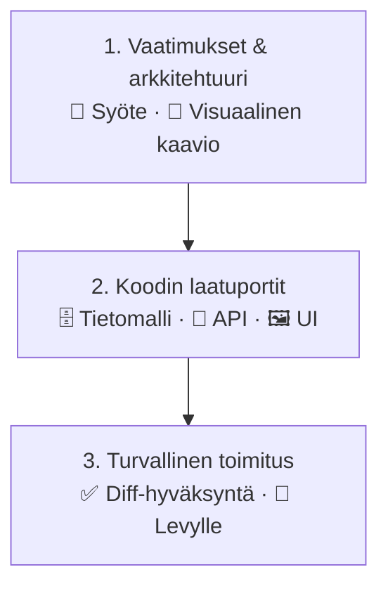
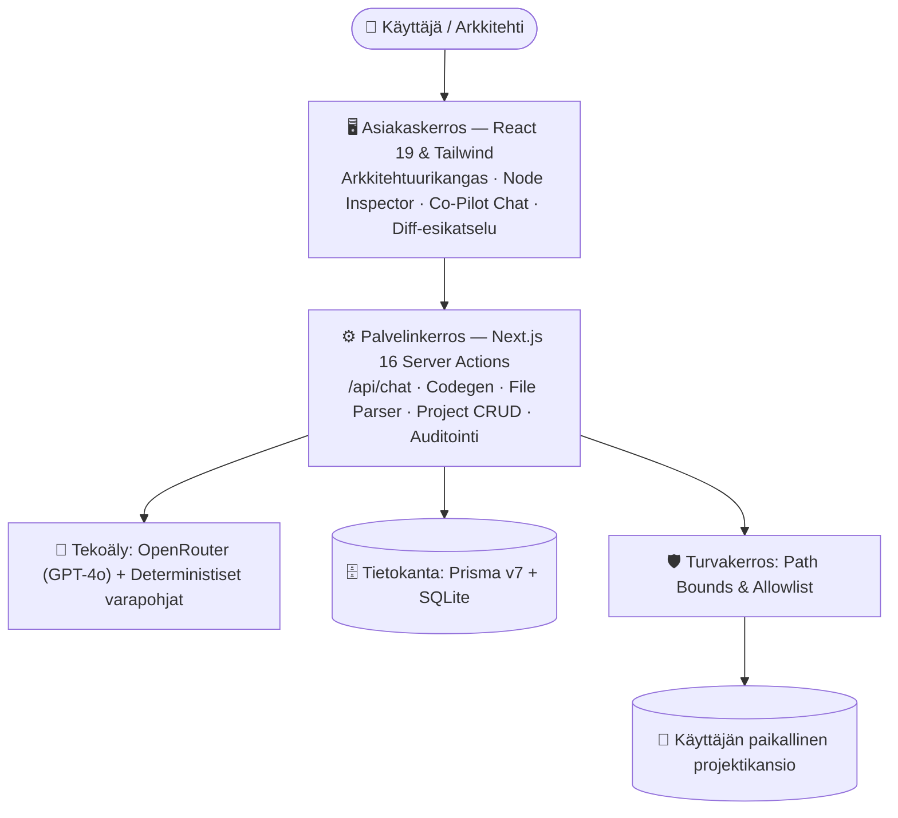

# Agentic Architect — Tuotealustan ja Visuaalisen Kankaan Tekninen Raportti

[](https://github.com/Samrude1/Agentic-Architect)
[](https://nextjs.org/)
[](https://react.dev/)
[](https://www.typescriptlang.org/)


> **Tekoälyavusteinen arkkitehtuuri- ja koodinluontityökalu, joka muuttaa liiketoimintavaatimuksen minuuteissa visuaaliseksi järjestelmäarkkitehtuuriksi ja siitä tarkastettavaksi, tuotantotyyliseksi koodiksi — niin, että ihminen hyväksyy jokaisen muutoksen ennen kuin mikään koskee levyyn.**

> 🏛️ **AGENTIC ENGINEERING SUITE — OSA 2: AGENTIC ARCHITECT (TUOTEALUSTA & VISUAALINEN KANGAS)**  
> **Tuotearkkitehtuurin ja Teknisen Toteutuksen Raportti (CTO / Tuotejohto / Lead Architect)**  
> Tämä raportti on itsenäinen tekninen erikoisosa kolmiosaisessa julkaisusarjassa:  
> • *Pääteos (Overview):* [01-master-brief-agentic-suite.md](./01-master-brief-agentic-suite.md) — Master Executive Brief  
> • *Osa 1 (Kehitysmoottori):* [02-part1-agentic-development-system.md](./02-part1-agentic-development-system.md) — Kehitysjärjestelmä & Insinööristandardit  
> • *Osa 2 (Tämä raportti):* Agentic Architect — Visuaalinen Kangas, 3x Data Gates & Deterministinen Levykirjoitus

📎 **Lähdekoodi:** [github.com/Samrude1/Agentic-Architect](https://github.com/Samrude1/Agentic-Architect) &nbsp;·&nbsp; **Arkkitehtuuri & toteutus:** Sami Rautanen ([samirautanen.fi](https://samirautanen.fi)) &nbsp;·&nbsp; **Lisenssi:** MIT

---

## 📑 Sisällys

**Osa I — Johdon yhteenveto (CEO)**
1. [Yhdellä silmäyksellä](#-yhdellä-silmäyksellä)
2. [Ongelma](#-ongelma-jonka-ratkaisemme)
3. [Ratkaisu](#-ratkaisu)
4. [Liiketoiminta-arvo](#-liiketoiminta-arvo)
5. [Arvo yksittäiselle käyttäjälle](#-arvo-yksittäiselle-käyttäjälle)
6. [Miksi tämä lähestymistapa](#-miksi-tämä-lähestymistapa-on-erilainen)
7. [Tilannekuva rehellisesti](#-tilannekuva-rehellisesti)

**Osa II — Tekninen syväsukellus (CTO)**
8. [Järjestelmäarkkitehtuuri](#️-järjestelmäarkkitehtuuri)
9. [Teknologiavalinnat ja perustelut](#️-teknologiavalinnat-ja-perustelut)
10. [Datavirta: vaatimuksesta levylle](#-datavirta-vaatimuksesta-levylle)
11. [Tekoälyintegraatio](#-tekoälyintegraatio)
12. [Tietoturva: monikerroksinen puolustus](#️-tietoturva-monikerroksinen-puolustus)
13. [Laatu, testaus ja mittarit](#-laatu-testaus-ja-mittarit)
14. [Kehitysmenetelmä](#-kehitysmenetelmä-ihminen--tekoälyagentti)
15. [Tekninen velka ja rajoitteet](#️-tekninen-velka-ja-tunnetut-rajoitteet)
16. [Tiekartta](#️-tiekartta)

---

# Osa I — Johdon yhteenveto

## 🎯 Yhdellä silmäyksellä

|                     |                                                                                                                                                                                                                                                       |
| :------------------ | :---------------------------------------------------------------------------------------------------------------------------------------------------------------------------------------------------------------------------------------------------- |
| **Mikä?**           | Selainpohjainen työkalu, joka kääntää tekstimuotoisen vaatimuksen tai spesifikaatiodokumentin (PDF/MD/TXT) interaktiiviseksi arkkitehtuurikaavioksi ja edelleen tietokanta-, rajapinta- ja käyttöliittymäkoodiksi.                                    |
| **Kenelle?**        | Teknisille perustajille, ohjelmistoarkkitehdeille, tiiminvetäjille ja itsenäisille ohjelmistokehittäjille.                                                                                                                                            |
| **Ongelma**         | Idean ja ensimmäisen toimivan koodin välissä on päiviä manuaalista suunnittelua, kaavioiden piirtämistä ja toistuvaa pohjakoodin kirjoittamista — ja tavalliset tekoälytyökalut tuottavat koodia, jota kukaan ei ole hyväksynyt arkkitehtuuritasolla. |
| **Ratkaisu**        | Kolmen *laatuportin* (Data Gate) putki: **tietomalli → rajapinnat → käyttöliittymä**. Jokainen vaihe on visuaalisesti tarkastettavissa, ja jokainen levylle kirjoitus vaatii ihmisen hyväksynnän rivi riviltä.                                        |
| **Erottava tekijä** | *Human-in-the-loop* turvallisuus, ei toimittajaloukkua (koodi on käyttäjän omaa), toimii myös ilman tekoäly-API-avainta.                                                                                                                              |
| **Kypsyys**         | Alpha. Visuaalinen kangas, AI Co-Pilot ja turvallinen levykirjoitus ovat vakaita; koodigenerointiportit ovat kenttätestauksessa.                                                                                                                      |
| **Mittakaava**      | ~15 300 riviä TypeScriptiä, 50 automaattista testiä, OWASP Top 10 -auditoitu, 0 TypeScript- ja lint-virhettä.                                                                                                                                         |

---

## 🧩 Ongelma, jonka ratkaisemme

Jokainen uusi ohjelmistoprojekti alkaa samalla tavalla — ja samoilla kustannuksilla:

1. **Vaatimukset ja tekninen toteutus puhuvat eri kieltä.** Liiketoiminta kirjoittaa "tarvitsemme asiakasportaalin, jossa on laskutus". Kehittäjä tarvitsee tietomallin, rajapinnat, autentikaation ja komponenttirakenteen. Tämän käännöksen tekeminen on hidasta, kallista ja altista väärinymmärryksille.
2. **Arkkitehtuuri elää ihmisten päässä.** Kaaviot piirretään erillisiin työkaluihin, ne vanhenevat heti ensimmäisen muutoksen jälkeen, eikä niistä synny koodia.
3. **Pohjakoodi syö asiantuntijan ajan.** Tietokantaskeemat, CRUD-rajapinnat, validoinnit ja hallintanäkymät ovat rakenteeltaan lähes samanlaisia projektista toiseen — silti seniorikehittäjä kirjoittaa ne yhä uudelleen.
4. **Tekoälykoodaustyökalut ratkaisevat väärän ongelman.** Ne tuottavat nopeasti *koodia*, mutta eivät *arkkitehtuuria*. Tuloksena on usein koodipohja, jonka rakennetta kukaan ei ole päättänyt, ja muutoksia, jotka on kirjoitettu suoraan tiedostoihin ilman tarkastusta.

> **Ydinhavainto:** Pullonkaula ei ole koodin kirjoittaminen — se on *oikean rakenteen päättäminen ja sen kääntäminen koodiksi hallitusti*.

---

## 💡 Ratkaisu

Agentic Architect asettaa **arkkitehtuurin** koodin edelle ja **ihmisen** tekoälyn yläpuolelle.




1. **Syöte** — Käyttäjä kirjoittaa idean vapaasti tai pudottaa spesifikaatiodokumentin.
2. **Visuaalinen arkkitehtuuri** — Tekoäly jäsentää vaatimukset neljäksi tasoksi (asiakas → API-yhdyskäytävä → palvelut → data) interaktiiviselle kankaalle. Arkkitehtuuria voi muokata keskustelemalla: *"Lisää Redis-välimuisti"* — ja kaavio päivittyy reaaliajassa.
3. **Laatuportit** — Hyväksytystä arkkitehtuurista generoidaan vaiheittain tietokantaskeema, validoidut rajapinnat ja käyttöliittymäkomponentit. Jokainen portti on erillinen tarkastuspiste.
4. **Turvallinen luovutus** — Mitään ei kirjoiteta sokkona. Käyttäjä näkee jokaisen muutoksen rivitasolla, olemassa olevista tiedostoista otetaan automaattisesti varmuuskopio, ja kirjoitukset on rajattu sallittuun projektikansioon.

Lisäksi työkalu sisältää sisäänrakennetun **tietoturva- ja optimointiauditoinnin** arvosanakortteineen sekä kaavioiden viennin PNG-, SVG- ja Mermaid-muotoihin dokumentaatiota varten.

---

## 🏢 Liiketoiminta-arvo

| Arvoalue                                                   | Mitä se tarkoittaa käytännössä                                                                                                                                                              |
| :--------------------------------------------------------- | :------------------------------------------------------------------------------------------------------------------------------------------------------------------------------------------ |
| **⏱️ Nopeampi idea → prototyyppi**                          | Arkkitehtuuriluonnos ja ensimmäinen koodirunko syntyvät saman istunnon aikana, ei viikkojen suunnittelusyklissä. Ideoita voidaan validoida ennen kuin niihin sitoudutaan isolla budjetilla. |
| **🗣️ Yhteinen kieli liiketoiminnan ja teknologian välille** | Visuaalinen kaavio on ymmärrettävä myös ei-teknisille sidosryhmille. Väärinymmärrykset paljastuvat kaaviossa — ei tuotannossa.                                                              |
| **🛡️ Hallittu tekoälyn käyttö**                             | Organisaatio saa tekoälyn tuottavuushyödyt ilman riskiä hallitsemattomista muutoksista: diff-esikatselu, varmuuskopiot ja polkurajaukset ovat oletuksena päällä.                            |
| **🔓 Ei toimittajaloukkua**                                 | Tuotettu koodi on tavallista Next.js-, Prisma- ja React-koodia käyttäjän omassa repossa. Ei suljettua alustaa, ei kuukausimaksua koodin ajamisesta.                                         |
| **📐 Johdonmukainen laatu**                                 | Generoidut rajapinnat noudattavat samoja käytäntöjä joka kerta (Zod-validointi, yhtenäiset virheformaatit), mikä vähentää koodikatselmointien kuormaa.                                      |
| **💰 Ennustettavat kustannukset**                           | Tekoälykutsut reititetään OpenRouterin kautta kustannustehokkaisiin malleihin, ja työkalu toimii varajärjestelmällä myös täysin ilman API-kuluja.                                           |

---

## 👤 Arvo yksittäiselle käyttäjälle

- **Arkkitehti / tiiminvetäjä** — Saa ajatuksensa nopeasti näkyväksi ja jaettavaksi kaavioksi, jonka voi viedä suoraan dokumentaatioon (Mermaid/SVG). Voi pyytää tekoälyltä auditoinnin yksittäiselle komponentille tai koko järjestelmälle.
- **Tekninen perustaja** — Pääsee ideasta toimivaan runkoon ilman tiimiä ja saa samalla perustellun teknologiasuosituksen: kevyt sovellus ei saa turhaa tietokantaa, raskas SaaS saa PostgreSQL:n, maksut ja sähköpostin.
- **Soolokehittäjä** — Rutiinikoodi (skeemat, CRUD, lomakkeet) generoidaan; aika vapautuu liiketoimintalogiikkaan. Diff-näkymä pitää kehittäjän kartalla siitä, mitä omaan koodiin päätyy.
- **Kaikki käyttäjät** — Turvallisuus on rakennettu sisään: työkalu ei voi kirjoittaa järjestelmäkansioihin, kotihakemiston juureen tai sallitun projektikansion ulkopuolelle.

---

## 🔍 Miksi tämä lähestymistapa on erilainen

|                                                  | Tyypillinen AI-koodiavustaja | No-code / low-code -alusta | **Agentic Architect** |
| :----------------------------------------------- | :--------------------------: | :------------------------: | :-------------------: |
| Lähtee arkkitehtuurista, ei rivikoodista         |              ❌               |             🟡              |           ✅           |
| Visuaalinen, muokattava järjestelmäkaavio        |              ❌               |             ✅              |           ✅           |
| Tuottaa tavallista, omistettavaa lähdekoodia     |              ✅               |             ❌              |           ✅           |
| Ihminen hyväksyy jokaisen tiedostomuutoksen      |              🟡               |             —              |           ✅           |
| Automaattiset varmuuskopiot ennen ylikirjoitusta |              ❌               |             —              |           ✅           |
| Toimii ilman tekoäly-API-avainta                 |              ❌               |             ✅              |           ✅           |
| Sisäänrakennettu tietoturva-auditointi           |              ❌               |             🟡              |           ✅           |

> **Filosofia:** Työkalu on tehty *skaalaamaan asiantuntijan työtä*, ei korvaamaan teknistä ymmärrystä. Tekoäly ehdottaa — ihminen päättää.

---

## 📊 Tilannekuva rehellisesti

Projekti on **aktiivisessa alpha-vaiheessa**. Tämä on tietoinen valinta: ydinarkkitehtuuri ja turvallisuusmekanismit on rakennettu ja testattu ensin, ja koodigenerointia vakautetaan oikeilla projekteilla.

| Osa-alue                                         |    Kypsyys    | Huomio                                                |
| :----------------------------------------------- | :-----------: | :---------------------------------------------------- |
| Visuaalinen arkkitehtuurikangas                  |    🟢 Vakaa    | 4-tasoinen automaattinen asettelu, animoidut yhteydet |
| AI Co-Pilot (striimaava keskustelu)              |    🟢 Vakaa    | Arkkitehtuurin muokkaus luonnollisella kielellä       |
| Turvallinen levykirjoitus, diff ja varmuuskopiot |    🟢 Vakaa    | Testattu yksikkö- ja tietoturvatesteillä              |
| Portit 1–3 (tietomalli, API, UI)                 |    🟡 Alpha    | Toimivat; kenttätestauksessa oikeilla projekteilla    |
| Co-Pilot ↔ porttien suora synkronointi           | ⚪ Suunniteltu | Seuraava kehitysaskel                                 |

**Todennettu käyttötapaus:** Työkalulla on generoitu ja auditoitu erillisen *PulseDesk*-projektin tietomalli ja rajapinnat (PostgreSQL, istunnot, roolipohjainen pääsynhallinta). Sisäänrakennettu auditointi antoi tulokselle arvosanan **A (95/100)**, 0 kriittistä löydöstä.

---
---

# Osa II — Tekninen syväsukellus

## 🏛️ Järjestelmäarkkitehtuuri

Sovellus on yksi Next.js 16 App Router -koodipohja, jossa frontend ja backend jakavat tyypit. Liiketoimintalogiikka on eristetty kehyksestä riippumattomiin moduuleihin (`architecture-agent.ts`, `codegen.ts`, `smart-templates.ts`, `path-security.ts`), mikä pienentää Next.js-sidonnaisuutta.



### Keskeiset moduulit

| Moduuli                                  | Vastuu                                                                                                  |
| :--------------------------------------- | :------------------------------------------------------------------------------------------------------ |
| `src/agents/architecture-agent.ts`       | Vaatimusten jäsennys rakenteiseksi node/edge-graafiksi, kuvausten generointi, avaimeton varajärjestelmä |
| `src/app/actions/codegen.ts`             | Porttien 1–3 orkestrointi: LLM-generointi, varajärjestelmä, levylle kirjoitus                           |
| `src/lib/codegen/smart-templates.ts`     | Deterministiset generaattorit Prisma-skeemoille, Route Handlereille ja React-komponenteille             |
| `src/lib/path-security.ts`               | Kohdepolun validointi, järjestelmäkansioiden esto, allowlist, path traversal -suojaus                   |
| `src/lib/diff.ts`                         | LCS-pohjainen rivitason diff-laskenta esikatselua varten                                                |
| `src/components/playground-workspace.tsx`| Työtilan tilan orkestrointi; välilehdet eriytetty `workspace/`-alikomponenteiksi                        |
| `src/lib/mermaid-export.ts`              | Puhdas, deterministinen kaavio → Mermaid -muunnin sanitoinnilla                                         |

---

## ⚙️ Teknologiavalinnat ja perustelut

Valinnat on dokumentoitu Architectural Decision Record -muodossa (ADR-0001: Core Technology Stack Selection), jossa vertailtiin kolmea vaihtoehtoa (Next.js + Prisma + SQLite, Vite + Express + MongoDB, Remix + Drizzle + PostgreSQL).

| Kerros         | Teknologia                    | Miksi tämä                                                                                                               |
| :------------- | :---------------------------- | :----------------------------------------------------------------------------------------------------------------------- |
| **Kehys**      | Next.js 16 (App Router)       | Server Actions poistavat erillisen API-palvelimen tarpeen; yksi `npm run dev` käynnistää koko järjestelmän               |
| **UI**         | React 19 + Tailwind CSS v4    | Concurrent Mode sujuvaan kankaan renderöintiin; design tokenit `STYLE_GUIDE.md`:ssä                                      |
| **Kangas**     | `@xyflow/react` v12           | Kypsä, React 19 -yhteensopiva graafimoottori custom-nodeilla                                                             |
| **AI**         | Vercel AI SDK v7 + OpenRouter | Tuotantotason striimaus (`streamText`, `useChat`, tool calling); mallinvaihto ilman SDK-muutoksia                        |
| **Data**       | Prisma v7 + libSQL (SQLite)   | Nolla infrastruktuuria paikallisesti; migraatio PostgreSQL:ään / Tursoon vain adapterin ja `DATABASE_URL`:n vaihdolla    |
| **Validointi** | Zod v4                        | Yksi skeema jaettuna Server Actionien, AI-työkalukutsujen ja kankaan validoinnin kesken                                  |
| **Testaus**    | Vitest v5 + Testing Library   | Sama TypeScript-ympäristö kuin sovelluksella; ei erillistä Babel-konfiguraatiota                                         |

**Tietoisesti hyväksytyt kompromissit** (ADR:stä):
- *SQLite ei skaalaudu monikäyttäjäkäyttöön* → paikallinen kehitystyökalu MVP-vaiheessa; PostgreSQL-polku valmiina.
- *Next.js-sidonnaisuus striimauksessa* → ydinlogiikka eristetty kehysriippumattomiin tiedostoihin.
- *30 s Edge-aikakatkaisu* → nopea oletusmalli (`gpt-4o-mini`), `maxDuration` konfiguroitu.

---

## 🔄 Datavirta: vaatimuksesta levylle

Vaatimuksen eteneminen käyttäjältä koodiksi tiedostojärjestelmään tapahtuu hallitusti viiden vaiheen kautta:

| Vaihe                  | Mitä tapahtuu                                                                                       |
| :--------------------- | :-------------------------------------------------------------------------------------------------- |
| **1. Syöte**           | `parseFileAction()` purkaa PDF/MD/TXT-tiedoston puhtaaksi tekstiksi                                 |
| **2. Arkkitehtuuri**   | LLM palauttaa graafin, joka validoidaan Zod-skeemaa vasten ennen kankaalle piirtoa                  |
| **3. Koodigenerointi** | Graafi + vaatimus LLM:lle; jos LLM ei vastaa, `smart-templates.ts` tuottaa koodin deterministisesti |
| **4. Hyväksyntä**      | Käyttäjä näkee rivitason diffin ja hyväksyy muutoksen                                               |
| **5. Kirjoitus**       | Kohde + allowlist + containment tarkistetaan, varmuuskopio `.agentic-backup/`, sitten kirjoitus     |

---

## 🧠 Tekoälyintegraatio

- **Striimaus ensin** — Co-Pilot käyttää AI SDK 7:n SSE-striimausta (`sendMessage`), ja pitkät synteesit visualisoidaan 3-vaiheisella edistymis-HUDilla. Käyttäjä ei koskaan tuijota tyhjää ruutua.
- **Rakenteiset tulosteet** — LLM:n tuottama arkkitehtuuri validoidaan Zod-skeemaa vasten ennen kuin se päätyy kankaalle. Virheellinen tuloste ei riko käyttöliittymää.
- **Graceful degradation** — Jokaisella AI-toiminnolla on deterministinen varajärjestelmä (`generateSmartPromptArchitecture`, `smart-templates.ts`). Sovellus on täysin demottavissa ilman API-avainta, ja varajärjestelmät ovat yksikkötestattavissa.
- **Mallineutraalius** — OpenRouter toimii yhdyskäytävänä; mallin vaihto (GPT, Claude, Gemini) on konfiguraatio, ei koodimuutos.
- **Kontekstitietoinen teknologiapäättely** — `inferTechStackAndEnv` luokittelee projektin kevyeksi, standardiksi tai raskaaksi SaaS:ksi ja generoi `.env.local.example`-tiedoston tarkkoine ohjeineen avainten hankintaan.
- **Token-säästö** — Tallennettu auditointiraportti avataan levyltä tai välimuistista (~2 ms, 0 tokenia); uusi LLM-tarkastus ajetaan vain eksplisiittisesti.

---

## 🛡️ Tietoturva: monikerroksinen puolustus

Työkalu kirjoittaa käyttäjän tiedostojärjestelmään, joten tietoturva on suunniteltu kerroksittain. Jokainen kerros on itsenäisesti testattu.

| Kerros                    | Mekanismi                                                                                                    | Toteutus                                   |
| :------------------------ | :----------------------------------------------------------------------------------------------------------- | :----------------------------------------- |
| **1. Kohdekansio**        | Levyn juuri, käyttäjän kotihakemisto ja järjestelmäkansiot (`Windows`, `System32`, `/etc`, `/usr` …) estetty | `validateProjectTargetPath()`              |
| **2. Tiedostopolku**      | Kovakoodattu allowlist sallituista kirjoituskohteista                                                        | `ALLOWED_WRITE_PATHS`                      |
| **3. Containment**        | `path.resolve` + `path.relative` -tarkistus estää `..`-ohitukset                                             | `validateProjectFileWritePath()`           |
| **4. Ihmisen hyväksyntä** | Rivitason diff-esikatselu ja vahvistusdialogi ennen jokaista kirjoitusta                                     | `DiffPreviewDialog`, `ConfirmActionDialog` |
| **5. Palautettavuus**     | Aikaleimattu varmuuskopio ennen ylikirjoitusta                                                               | `.agentic-backup/`                         |
| **6. Syötteet**           | Zod-validointi kaikissa API-reiteissä; MIME-tarkistus tiedostoille                                           | `/api/chat`, `file-parser.ts`              |
| **7. Salaisuudet**        | API-avaimet vain palvelinpuolella `.env.local`:ssa; ei `NEXT_PUBLIC_`-vuotoja                                | Tarkistettu skannauksella                  |
| **8. HTTP**               | CSP, `X-Frame-Options`, `X-Content-Type-Options`, `Referrer-Policy`, `Permissions-Policy`                    | `next.config.ts`                           |

**Haavoittuvuushallinta:** Next.js päivitettiin 16.3.5:een, mikä korjasi 1 kriittisen ja 10 korkean tason CVE:n (SSRF, RCE, middleware-ohitus). Jäljellä olevat 4 ilmoitusta koskevat ainoastaan Prisma CLI:n kehitystyökaluketjua (`mysql2`), jota ei suoriteta ajonaikaisesti — riski on analysoitu ja dokumentoitu (`SECURITY_AUDIT.md`).

---

## 🧪 Laatu, testaus ja mittarit

| Mittari                          | Tulos                                                                                                        |
| :------------------------------- | :----------------------------------------------------------------------------------------------------------- |
| **Yksikkö- ja tietoturvatestit** | 50 testiä, 11 testitiedostoa, 100 % läpäisy (Vitest)                                                         |
| **Tyyppiturvallisuus**           | TypeScript strict, `tsc --noEmit` → 0 virhettä                                                               |
| **Staattinen analyysi**          | `npm run lint` → 0 virhettä, 0 varoitusta                                                                    |
| **Tuotantobuild**                | Turbopack-käännös ~16 s, 6 reittiä esirenderöity ilman hydraatiovirheitä                                     |
| **Saavutettavuus**               | Radix UI -dialogit (`DialogTitle`/`DialogDescription`), näkyvät fokusindikaattorit, korkeakontrastinen teema |
| **Koodikanta**                   | ~15 300 riviä TypeScriptiä, 52 commitia                                                                      |

**Testikattavuus painottuu riskialueisiin:** polkuturvallisuus ja path traversal, dokumenttien jäsennys, arkkitehtuurimoottorin tasojako, API- ja UI-koodigenerointi, teknologiapäättely, Mermaid-vienti ja auditointiraporttien välimuisti.

**Refaktorointi on osa prosessia:** Monoliittinen 1 170-rivinen työtilakomponentti pilkottiin 7 alikomponentiksi, ja 600 riviä generaattorilogiikkaa eriytettiin omaksi moduulikseen (`codegen.ts` 1 060 → 460 riviä).

---

## 🤝 Kehitysmenetelmä: ihminen + tekoälyagentti

Tämä projekti noudattaa kehitysmallia, jossa asiantuntija ohjaa tekoälyagenttia rakenteisen prosessin kautta.

- **Yksi totuuden lähde** — Vaatimukset, arkkitehtuuri, tyyliopas, tietoturva-auditointi ja tila elävät versionhallitussa `.agents/blueprint/`-hakemistossa (`PRD.md`, `ARCHITECTURE.md`, `PROJECT_STATUS.md`).
- **Päätökset dokumentoidaan** — Arkkitehtuuripäätökset ADR-muodossa, kehityshistoria `DEV_LOG.md`:ssa, viat juurisyyanalyyseineen `KNOWN_BUGS.md`:ssa.
- **Toistettavat työnkulut** — 18 erikoistunutta agenttitaitoa (UI, API, tietokanta, tietoturva, testaus, suorituskyky, CI/CD, dokumentaatio) slash-komentoina, joilla on yhtenäiset laatukriteerit ja virheenkäsittelyprotokollat.
- **Istuntojen välinen muisti** — `/save`- ja `/resume`-käytäntö säilyttää kontekstin ja minimoi token-kulutuksen.

> Järjestelmä on suunniteltu osoittamaan, miten tekoälyavusteinen kehitysprosessi voidaan vakioida, auditoida ja hallita läpinäkyvästi osana ammattimaista ohjelmistotuotantoa.

---

## ⚠️ Tekninen velka ja tunnetut rajoitteet

Rehellinen lista on osa ammattimaista toimitusta:

| Aihe                         | Prioriteetti | Tila ja suunnitelma                                                                                                                                                                |
| :--------------------------- | :----------: | :--------------------------------------------------------------------------------------------------------------------------------------------------------------------------------- |
| **Co-Pilot ↔ portit -silta** |    Korkea    | Co-Pilotin korjaussuunnitelma ei vielä välity automaattisesti porttien generaattoreille. Ratkaisu: `update_gate_code`-työkalu tai auditointiraportin syöttö generointikontekstiin. |
| **E2E-testit**               |  Keskitaso   | Yksikkötestit kattavat logiikan; Playwright-käyttäjäpolkutestit suunnitteilla.                                                                                                     |
| **CSP-kiristys**             |    Matala    | `'unsafe-inline'`/`'unsafe-eval'` sallittu kankaan vuoksi; nonce/SRI-malli ennen tiukkaa tuotantokäyttöönottoa.                                                                    |
| **Monikäyttäjäisyys**        | Matala (MVP) | Paikallinen yhden käyttäjän työkalu; autentikaatio ja PostgreSQL ennen SaaS-julkaisua.                                                                                             |
| **Prisma CLI -CVE:t**        | Seurannassa  | Ei ajonaikaista vaikutusta; seurataan Prisma v7 -päivityksiä.                                                                                                                      |

---

## 🗺️ Tiekartta

Nykyinen MVP kattaa arviolta **65–70 %** pitkän aikavälin visiosta (Tuotevisio / Future Vision).

| ✅ Toteutettu (MVP)              | 🔜 Seuraava vaihe          | 🔭 Visio                                           |
| :------------------------------ | :------------------------ | :------------------------------------------------ |
| Visuaalinen arkkitehtuurikangas | Co-Pilot ↔ porttien silta | LangGraph-orkestrointi ja ihmisen pysäytyspisteet |
| AI Co-Pilot (striimaus)         | Playwright E2E -testit    | Autonominen testaa → korjaa -sykli                |
| Portit 1–3 (DB, API, UI)        | Monitiedostosyöte         | Sandpack / WebContainer -esikatselu               |
| Turvallinen levykirjoitus       |                           | AWS SQS + Lambda -skaalaus                        |
| Auditointi ja kaavioiden vienti |                           | Kustannusoptimoitu mallireititys                  |

**Pitkän aikavälin tavoite:** autonominen kehitysalusta, jossa agentti suorittaa *toteuta → validoi → iteroi → luovuta* -sykliä ja siirtää ominaisuuden asiantuntijan hyväksyttäväksi vasta, kun kaikki laatuportit on läpäisty. Toimitusmallina on lähdekoodin luovutus — asiakas omistaa tuotetun ohjelmiston kokonaan ja voi ajaa sen omassa pilviympäristössään.

---

## 📬 Lisätietoja & Linkit

| Resurssi                      | Kuvaus / Sijainti                                                      |
| :---------------------------- | :--------------------------------------------------------------------- |
| Dokumentaatiokeskus (Hakemisto) | [docs/README.md](./README.md) (Suositeltu lukujärjestys & roolioppaat) |
| Master Executive Brief        | [01-master-brief-agentic-suite.md](./01-master-brief-agentic-suite.md) (Strateginen päädokumentti: Part 1 + Part 2) |
| Kehitysjärjestelmä & Metodologia | [02-part1-agentic-development-system.md](./02-part1-agentic-development-system.md) (Osa 1: Insinööristandardit & moottori) |
| Arkkitehtuuripäätökset (ADR)  | [docs/adr/](./adr/README.md) (ADR-0001: Teknologiapinovalinta)         |
| Tietoturva-auditointi         | [.agents/blueprint/SECURITY_AUDIT.md](../.agents/blueprint/SECURITY_AUDIT.md) (OWASP Top 10 -tarkastus) |
| Lähdekoodi ja tekninen README | [github.com/Samrude1/Agentic-Architect](https://github.com/Samrude1/Agentic-Architect) |

---

## 🏛️ Dokumentaatiosarjan Kokonaisuus

```text
┌────────────────────────────────────────────────────────────────────────────────────────────┐
│  AGENTIC ENGINEERING SUITE — JULKAISUSARJA                                                 │
├────────────────────────────────────────────────────────────────────────────────────────────┤
│  [01] Agentic Engineering Suite — Master Executive Brief                                   │
│       Yksikköekonomia, laatuportit, arvolupaus, teknologiamatriisi (CEO/CTO/Board)         │
├────────────────────────────────────────────────────────────────────────────────────────────┤
│  [02] Part 1 — Agentic Fullstack Development System (Kehitysmoottori)                      │
│       18 agenttityökalua, kognitiivinen muisti, OWASP-turvallisuus, laatusykli (CTO/Lead)  │
├────────────────────────────────────────────────────────────────────────────────────────────┤
│  [03] Part 2 — Agentic Architect [TÄMÄ DOKUMENTTI]                                         │
│       4-tasoinen interaktiivinen kangas, 3x data gates, turvalevykirjoitus (CTO/Product)   │
└────────────────────────────────────────────────────────────────────────────────────────────┘
```

*Agentic Architect &nbsp;·&nbsp; Osa Agentic Engineering Suitea &nbsp;·&nbsp; Arkkitehtuuri & Toteutus: **Sami Rautanen** ([samirautanen.fi](https://samirautanen.fi)) &nbsp;·&nbsp; Lisenssi: MIT*
