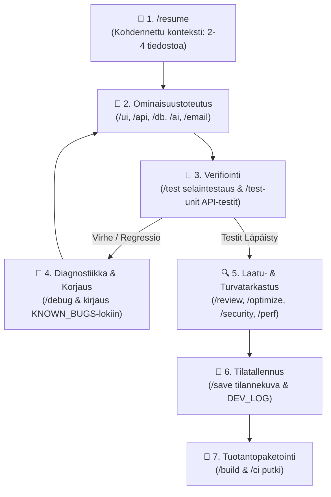

# 🏛️ Agentic Fullstack Development System
## Tuotekehityksen ja Teknisen Arkkitehtuurin Raportti

[](#2-tekninen-arkkitehtuuri--toteutus)
[](#23-tietoturva-ja-laadunvarmistus-shift-left-security)
[](#22-kontekstin-hallinta-ja-context-rot--ongelman-ratkaisu)
[](#26-teknologiapino-ja-framework-agnostisuus)

> 🏛️ **AGENTIC ENGINEERING SUITE — OSA I (1/2): KEHITYSJÄRJESTELMÄ & METODOLOGIA**  
> **Tekninen Arkkitehtuuriraportti (CTO / Lead Architect -taso)**  
> Tämä raportti on itsenäinen erikoisosa kolmiosaisessa julkaisusarjassa:  
> • *Pääteos (Overview):* Agentic Engineering Suite — Strateginen ja Tekninen Järjestelmäkatsaus  
> • *Osa I (Tämä raportti):* Agentic Fullstack Development System — Insinööristandardit & Kognitiivinen Hallinta  
> • *Osa II (Tuotealusta):* Agentic Architect — Visuaalinen Kangas & Deterministiset Laatuportit

---

## 📑 Sisällysluettelo
- [🏛️ Agentic Fullstack Development System](#️-agentic-fullstack-development-system)
  - [Tuotekehityksen ja Teknisen Arkkitehtuurin Raportti](#tuotekehityksen-ja-teknisen-arkkitehtuurin-raportti)
  - [📑 Sisällysluettelo](#-sisällysluettelo)
  - [1. Strateginen Arvolupaus \& Liiketoimintahyödyt](#1-strateginen-arvolupaus--liiketoimintahyödyt)
    - [1.1 Ydinongelma: Hallitsematon "Vibe Coding" vs. Deterministinen ohjelmistotuotanto](#11-ydinongelma-hallitsematon-vibe-coding-vs-deterministinen-ohjelmistotuotanto)
    - [1.2 Mitattava Liiketoimintahyöty (Quantifiable ROI)](#12-mitattava-liiketoimintahyöty-quantifiable-roi)
    - [1.3 Kehittäjän Tuottavuus ja Skaalaus (Developer Leverage)](#13-kehittäjän-tuottavuus-ja-skaalaus-developer-leverage)
    - [1.4 Strateginen Vertailumatriisi](#14-strateginen-vertailumatriisi)
  - [2. Tekninen Arkkitehtuuri \& Toteutus](#2-tekninen-arkkitehtuuri--toteutus)
    - [2.1 Kognitiivinen Hallintajärjestelmä (`.agents/`-ekosysteemi)](#21-kognitiivinen-hallintajärjestelmä-agents-ekosysteemi)
    - [2.2 Kontekstin Hallinta ja "Context Rot" -ongelman Ratkaisu](#22-kontekstin-hallinta-ja-context-rot--ongelman-ratkaisu)
    - [2.3 Tietoturva ja Laadunvarmistus (Shift-Left Security)](#23-tietoturva-ja-laadunvarmistus-shift-left-security)
    - [2.4 Autonominen Laatusykli (The Closed Loop)](#24-autonominen-laatusykli-the-closed-loop)
    - [2.5 18 Tuotantotason Kyvykkyyttä (Skills \& Workflow Matrix)](#25-18-tuotantotason-kyvykkyyttä-skills--workflow-matrix)
    - [2.6 Teknologiapino ja Framework-agnostisuus](#26-teknologiapino-ja-framework-agnostisuus)
  - [3. Järjestelmän Tuotantovalmius](#3-järjestelmän-tuotantovalmius)
    - [3.1 Järjestelmätason Kyvykkyydet](#31-järjestelmätason-kyvykkyydet)
    - [3.2 Välitön Tuotantoarvo ja Käyttöönotto](#32-välitön-tuotantoarvo-ja-käyttöönotto)
    - [📌 Tekninen Katselmointi](#-tekninen-katselmointi)

---

## 1. Strateginen Arvolupaus & Liiketoimintahyödyt

**Agentic Fullstack Development System** on ammattimaisen ohjelmistokehityksen kognitiivinen kehys ja hallintajärjestelmä. Se mahdollistaa kokeneen sovelluskehittäjän toimimisen moninkertaisella tuotekehitysnopeudella hyödyntämällä autonomisia tekoälyagentteja (Antigravity IDE, Cursor, Claude Code) ilman hallitsemattoman tekoälykoodauksen riskejä.

Järjestelmä pakottaa tekoälyn noudattamaan versionhallittuja arkkitehtuurisopimuksia, automaattisia laatuportteja ja OWASP-tietoturvastandardeja jokaisella koodirivillä.

```text
┌────────────────────────────────────────────────────────────────────────┐
│                        LIIKETOIMINNAN YDINTULOKSET                     │
├────────────────────────────────────────────────────────────────────────┤
│ 🚀 Time-to-Market:      Uudet ominaisuudet ja MVP-tuotteet 3-5x nopeammin│
│ 💰 Kustannussäästö:     -70 % tekoälyn token-kustannuksista, vähemmän  │
│                         teknistä velkaa ja korjauskuluja               │
│ 🛡️ Riskinhallinta:      Nollatoleranssi kovakoodatuille salaisuuksille  │
│                         ja tietoturva-aukoille (Shift-Left Security)   │
│ 📈 Skaalautuvuus:       Dokumentoitu, modulaarinen arkkitehtuuri, joka │
│                         on suoraan uuden tiimiläisen jatkokehitettävissä│
└────────────────────────────────────────────────────────────────────────┘
```

---

### 1.1 Ydinongelma: Hallitsematon "Vibe Coding" vs. Deterministinen ohjelmistotuotanto

Modernit tekoälymallit tuottavat koodia poikkeuksellisen nopeasti, mutta ilman deterministisiä rajoja nopea generointi synnyttää kriittisiä ongelmia:

1. **Arkkitehtuurin mureneminen (Architectural Drift)**: Jokainen uusi tekoälykehote synnyttää helposti erillisiä ratkaisuja: ristiriitaisia väripaletteja, ad-hoc-tyylityksiä, satunnaisia lisäkirjastoja ja hajanaisia API-sopimuksia.
2. **Kontekstin rapautuminen (Context Rot)**: Projektin kasvaessa mallille syötetään liikaa koodia kerralla. Tämä heikentää päättelytarkkuutta, lisää hallusinointia ja nostaa tekoälyn käyttökustannuksia.
3. **Piilevät tietoturvapuutteet**: Ilman automaattista valvontaa nopea koodaus jättää huomiotta syötteiden validoinnin, SQL-injektiosuojauksen ja roolipohjaisen autorisoinnin.
4. **Ylläpidon vaikeutuminen**: Hallitsemattomasti generoitu koodi muodostaa nopeasti vaikeasti ylläpidettävää spagettikoodia.

**Ratkaisu**: Järjestelmä asettaa tekoälylle **deterministiset laatu- ja arkkitehtuuriohjaimet**. Tekoäly toimii kurinalaisena, automatisoituna insinöörinä, jonka jokaista ratkaisua ohjaa versionhallittu arkkitehtuurisopimus.

---

### 1.2 Mitattava Liiketoimintahyöty (Quantifiable ROI)

| Liiketoimintamittari         | Perinteinen kehitystapa                   | Hallitsematon AI ("Vibe Coding")           | Agentic Fullstack System                                            |
| :--------------------------- | :---------------------------------------- | :----------------------------------------- | :------------------------------------------------------------------ |
| **Kehitysnopeus (Velocity)** | Viikkojen manuaaliset syklit.             | Nopea alussa, hidastuu virheisiin.         | **3–5x nopeampi tuotantovalmius alusta loppuun**.                   |
| **Tekoälykulut (Token ROI)** | Ei suoraa AI-kulua.                       | Korkea (koko koodikannan toistuva lataus). | **Jopa 70 % pienemmät token-kulut** kohdennetulla tilanhallinnalla. |
| **Laatu ja Regressiot**      | Riippuu manuaalisesta testauksesta.       | Paljon piileviä regressioita.              | **Automaattiset selain- ja yksikkötestiportit** ennen hyväksyntää.  |
| **Tietoturva**               | Tarkastukset usein vasta ennen julkaisua. | Korkea riski tietovuodoille.               | **Reaaliaikainen OWASP Top 10 -tarkastus** kehityssyklissä.         |
| **Dokumentaatio & Ylläpito** | Vanhenee usein koodin edetessä.           | Puuttuu usein kokonaan.                    | **Aina ajantasainen arkkitehtuuri, API-kuvaus ja Runbook**.         |

---

### 1.3 Kehittäjän Tuottavuus ja Skaalaus (Developer Leverage)

Järjestelmä poistaa yksittäisen kehittäjän pullonkaulat:

1. **Rutiinitehtävien eliminointi**: Standardoidut API-reitit, tietokantamallit, syötevalidoinnit ja sähköpostipohjat muodostuvat sekunneissa testattujen käytäntöjen mukaisesti.
2. **Kognitiivinen jatkuvuus**: Tilanhallintakomennot (`/save` ja `/resume`) takaavat saumattoman työskentelyn taukojen ja sprinttien välillä ilman kontekstin katoamista.
3. **Tasalaatuinen tuotantolaatu**: Esteettömyys (WCAG 2.1 AA), virheenkäsittely ja dokumentaatio toteutuvat automaattisesti osana jokaista ominaisuutta.

---

### 1.4 Strateginen Vertailumatriisi

```text
┌─────────────────────────┬──────────────────────────┬──────────────────────────┬──────────────────────────┐
│ MITTARI                 │ PERINTEINEN DEV-TIIMI    │ HALLITSEMATON AI-KOODAUS │ AGENTIC FULLSTACK SYSTEM │
├─────────────────────────┼──────────────────────────┼──────────────────────────┼──────────────────────────┤
│ Resurssitarve           │ 3–5 kehittäjää           │ 1 kehittäjä              │ 1 lead-arkkitehti + agentit │
│ Kehityssykli            │ Viikkoja / kuukausia     │ Päiviä (korkea hauraus)  │ Tunteja / päiviä (vakaa) │
│ Arkkitehtuurikoheesio   │ Vaihteleva               │ Matala (spagetti)        │ Deterministinen & tiukka │
│ Tietoturvataso          │ Vaihteleva               │ Korkea haavoittuvuus     │ OWASP Top 10 -valvottu   │
│ Tuotantodokumentaatio   │ Vaatii erillisen ajan    │ Puutteellinen            │ Automaattinen & synkassa │
└─────────────────────────┴──────────────────────────┴──────────────────────────┴──────────────────────────┘
```

---

## 2. Tekninen Arkkitehtuuri & Toteutus

Järjestelmä perustuu modulaariseen ja tarkasti rajattuun kognitiiviseen rakenteeseen, jossa arkkitehtuuritiedot, insinöörisäännöt ja työkalut on erotettu toisistaan.

### 2.1 Kognitiivinen Hallintajärjestelmä (`.agents/`-ekosysteemi)

```
.agents/
├── blueprint/          # 📌 SINGLE SOURCE OF TRUTH (Yhteinen totuuspohja)
│   ├── PRD.md              # Tuotevaatimukset, käyttäjätarinat ja hyväksymiskriteerit
│   ├── ARCHITECTURE.md     # Moduulivastuut, tiedostohierarkia ja datavirrat
│   ├── STYLE_GUIDE.md      # Globaalit CSS :root tokenit, värit, typografia, komponentit
│   ├── PROJECT_STATUS.md   # Sprinttitilanne, ominaisuusmatriisi ja tekninen velka
│   ├── SECURITY_AUDIT.md   # OWASP-tulokset, haavoittuvuusseuranta ja toimenpiteet
│   └── SESSION_STATE.md    # Aktiivinen kontekstitila ja seuraavat askeleet
│
├── rules/              # 🛡️ DETERMINISTISET LAATULAIT (Insinööristandardit)
│   └── fullstack-dev.md    # Sitovat säännöt: Zod-validointi, API-envelope, a11y, CORS
│
└── skills/             # ⚡ 18 AUTONOMISTA TYÖKALUA & TYÖVUOTA
    ├── app-init/           # Grill-Me haastattelu & pinojen alustus
    ├── app-ui/             # Design-systeemin mukaiset komponentit
    ├── app-api/            # Zod-suojatut REST/RPC-reitit & virhekäsittely
    ├── app-db/             # Skeemat, relaatiot, migraatiot & siementieto
    ├── app-ai/             # Vercel AI SDK, stream-vastaukset, token-budjetit
    ├── app-security/       # OWASP Top 10, salaisuusvuodot, SQLi-tarkastukset
    ├── app-test/           # Autonominen selainagentti (Headless UI/E2E)
    ├── app-test-unit/      # Vitest / Jest -yksikkö- ja integraatiotestit
    ├── app-perf/           # Core Web Vitals, bundle-analyysi, välimuistitus
    ├── app-ci/             # GitHub Actions CI/CD ja Dependabot-putket
    └── app-docs/           # Standard README, Runbook, API-dokumentaatio
```

---

### 2.2 Kontekstin Hallinta ja "Context Rot" -ongelman Ratkaisu

Laajojen koodikantojen syöttäminen kokonaisuudessaan LLM-kontekstiin aiheuttaa päättelytarkkuuden heikkenemistä ja tarpeetonta kustannustaakkaa.

Järjestelmä käyttää **kohdennettua tilasiirtoprotokollaa (`app-memory`)**:
1. Istunnon alussa (`/resume`) ladataan **vain 2–4 ennalta määriteltyä ydintiedostoa**:
   - `SESSION_STATE.md` (edellisen istunnon tulokset ja aktiivinen fokusalue)
   - `PROJECT_STATUS.md` (aktiivinen sprintti ja tehtävälista)
   - Työn alla oleva spesifikaatio (`PRD.md` tai `ARCHITECTURE.md`)
2. Istunnon päättyessä (`/save`) analysoidaan tehdyt muutokset, kirjataan toimenpiteet kehityslokiin (`DEV_LOG.md`) ja päivitetään `SESSION_STATE.md` seuraavaa istuntoa varten.
3. Menetelmä vähentää token-kulutusta jopa **70 %** ja varmistaa virheettömän kontekstin läpi pitkienkin kehityssyklien.

---

### 2.3 Tietoturva ja Laadunvarmistus (Shift-Left Security)

Tietoturva on integroitu suoraan koodausprosessiin eikä erilliseksi jälkivaiheeksi:

- **Pakotettu Syötevalidointi (Zod Input Sanitation)**: Kaikki API-rajapinnat tarkistavat saapuvan datan Zod-skeemalla ennen käsittelyä. Virheelliset pyynnöt pysähtyvät standardoituun 400-vastaukseen.
- **Yhtenäinen Vastauskuori (Standard Response Envelope)**:
  ```typescript
  // Onnistunut vastaus
  { success: true, data: { ... }, meta?: { ... } }

  // Virhevastaus (sisäisiä virhepinotietoja ei koskaan vuodeta asiakkaalle)
  { success: false, error: { code: "INVALID_CREDENTIALS", message: "..." } }
  ```
- **Suojatut Tietokantakyselyt**: Raaka merkkijonoyhdistely on kielletty. Kaikki operaatiot käyttävät parametrisoituja kyselyjä tai tyyppiturvallisia ORM-kerroksia (Prisma, Drizzle).
- **Salaisuuksien Hallinta**: Automaattinen tarkastus estää API-avainten ja ympäristömuuttujien päätymisen versionhallintaan.

---

### 2.4 Autonominen Laatusykli (The Closed Loop)

Koodimuutosten läpivienti etenee järjestelmällisen laatusyklin kautta:



---

### 2.5 18 Tuotantotason Kyvykkyyttä (Skills & Workflow Matrix)

Järjestelmä sisältää 18 automatisoitua insinöörikyvykkyyttä jaettuna elinkaari- ja domain-alueisiin:

| Kategoria     | Komento      | Kyvykkyys (Skill) | Toiminnallisuus ja Tuotokset                                                                  |
| :------------ | :----------- | :---------------- | :-------------------------------------------------------------------------------------------- |
| **Lifecycle** | `/resume`    | `app-memory`      | Palauttaa edellisen istunnon tilan token-tehokkaasti.                                         |
| **Lifecycle** | `/init`      | `app-init`        | 6 kysymyksen Grill-Me arkkitehtuurihaastattelu, PRD & stack-alustus.                          |
| **Lifecycle** | `/onboard`   | `app-onboard`     | Auditoi olemassa olevan koodikannan ja muodostaa sille täyden `.agents/blueprint/`-rakenteen. |
| **Lifecycle** | `/test`      | `app-test`        | Headless-selainagentti: renderöinti, konsolipoikkeukset, lomakkeet ja responsiivisuus.        |
| **Lifecycle** | `/test-unit` | `app-test-unit`   | Automaattiset Vitest/Jest-yksikkö-, integraatio- ja Zod-skeematestit kattavuusvahdeilla.      |
| **Lifecycle** | `/ci`        | `app-ci`          | GitHub Actions CI/CD -putki, PR-tarkastusportit ja Dependabot-konfiguraatio.                  |
| **Lifecycle** | `/docs`      | `app-docs`        | README, Changelog, REST API -dokumentaatio ja Operational Runbook.                            |
| **Lifecycle** | `/debug`     | `app-debug`       | Juurisyyanalyysi (CORS, hydraatio, JWT), korjaukset ja lokitus `KNOWN_BUGS.md`-tiedostoon.    |
| **Lifecycle** | `/review`    | `app-review`      | Koodikatselmointi: WCAG 2.1 AA, Core Web Vitals ja arkkitehtuurin puhtaus.                    |
| **Lifecycle** | `/optimize`  | `app-optimize`    | Refaktorointi: monoliittien purkaminen ja modulaarisuuden optimointi.                         |
| **Lifecycle** | `/save`      | `app-memory`      | Päivittää tilannekuvan, kirjaa kehityslokin ja valmistelee seuraavan istunnon handoffin.      |
| **Lifecycle** | `/build`     | `app-deploy`      | Tuotantobuildin varmistus, Docker-monivaihekontit ja hosting-julkaisut.                       |
| **Domain**    | `/ui`        | `app-ui`          | Responsiiviset komponentit tiukasti `STYLE_GUIDE.md`-tokeneilla (Dark & Light).               |
| **Domain**    | `/api`       | `app-api`         | Zod-validoitu REST/RPC-päätepiste, roolipohjainen suojaus ja standardi envelope.              |
| **Domain**    | `/db`        | `app-db`          | Relaatiotietokantamallit, indeksointi, migraatiot (Prisma/Drizzle) ja siementiedot.           |
| **Domain**    | `/ai`        | `app-ai`          | LLM-integraatiot: Vercel AI SDK, stream-vastaukset, strukturoitu JSON ja token-budjetit.      |
| **Domain**    | `/email`     | `app-email`       | Transaktiosähköpostit: React Email -pohjat, monitoimittajatuki (Resend/SendGrid), SPF/DKIM.   |
| **Domain**    | `/perf`      | `app-perf`        | Core Web Vitals (INP < 200ms, LCP < 2.5s), bundle-analyysi ja välimuistit.                    |
| **Domain**    | `/security`  | `app-security`    | OWASP Top 10 tarkastus, kovakoodattujen salaisuuksien skannaus ja CVE-tarkistukset.           |

---

### 2.6 Teknologiapino ja Framework-agnostisuus

Järjestelmä on riippumaton yksittäisestä koodikehyksestä ja mukautuu organisaation teknologiapolitiikkaan:

- **Frontend**: Next.js (App Router), Vite + React, SvelteKit, Astro tai Vanilla HTML/CSS/TS.
- **Backend**: Next.js Server Actions / Route Handlers, Fastify, Express, Hono tai Serverless Functions.
- **Data & Tallennus**: PostgreSQL, SQLite, Supabase, MongoDB (Prisma, Drizzle tai raw SQL).
- **Autentikaatio**: NextAuth / Auth.js, Clerk, Supabase Auth tai HTTP-only JWT-evästeet.
- **Infrastruktuuri**: Docker, Vercel, Netlify, Railway, AWS ECS tai staattinen hosting CDN:n takana.

---

## 3. Järjestelmän Tuotantovalmius

Tämä kehys toimii suoraan perustana nykyaikaiselle ohjelmistokehitykselle ja vaativalle tekoälyintegraatioiden hallinnalle.

### 3.1 Järjestelmätason Kyvykkyydet

Kehyksen rakenne heijastaa nykyaikaisia vaatimuksia ohjelmistotuotannon eri osa-alueilla:

1. **Metatason Arkkitehtuuri**: Mahdollisuus luoda automatisoituja, virheitä ennaltaehkäiseviä kehitysympäristöjä, jotka skaalaavat ohjelmistotuotannon laatua.
2. **Käytännön LLM-ohjaus**: Tekoälymallien rajoitteiden (hallusinointi, kontekstihävikki, tyylidrifti) ratkaiseminen deterministisillä koodisäännöillä.
3. **Päästä-päähän -laadunvarmistus**: Sisäänrakennettu tuki design-systeemeille (CSS tokens, esteettömyys), backend-arkkitehtuurille, tietoturva-auditoinnille ja automatisoiduille CI/CD-putkille.
4. **Liiketoimintakeskeinen Suunnittelu**: Työkalujen optimointi lyhentämään toimitusaikoja ja pienentämään ylläpitokustannuksia.

---

### 3.2 Välitön Tuotantoarvo ja Käyttöönotto

Järjestelmä tarjoaa suoran pohjan tuotantokäyttöön:

- **Välitön Tuottavuus**: Standardoidut menetelmät, laatuportit ja arkkitehtuurikäytännöt ovat valmiina käyttöönotettavaksi ilman erillistä alustusaikaa.
- **Kontrolloitu Tekoälyhyöty**: Mahdollistaa turvallisen ja auditoitavissa olevan tekoälyavusteisen koodituotannon organisaatiossa.
- **Ylläpidettävä Koodikanta**: Automaattisesti ylläpidetyt laatuportit varmistavat, että sovellus pysyy laajennettavana ja puhtaana läpi koko elinkaarensa.

---

### 📌 Tekninen Katselmointi

- **Julkaisu**: `Agentic Fullstack Development System` (MIT-lisenssi)
- **Tekijä & Arkkitehti**: Sami Rautanen ([samirautanen.fi](https://samirautanen.fi))
- **Käyttöönotto**: Valmis kloonattavaksi ja suoraan hyödynnettävissä tuotantoprojekteissa (`/init` tai `/onboard`).

---

## 🏛️ Dokumentaatiosarjan Kokonaisuus

```text
┌────────────────────────────────────────────────────────────────────────────────────────┐
│  🏛️ AGENTIC ENGINEERING SUITE — JULKAISUSARJA                                          │
├────────────────────────────────────────────────────────────────────────────────────────┤
│  📜 PÄÄDOKUMENTTI: Agentic Engineering Suite — Strateginen Järjestelmäkatsaus          │
│     Yksikköekonomia, laatuportit, arvolupaus, teknologiamatriisi (CEO/CTO/Board)       │
├────────────────────────────────────────────────────────────────────────────────────────┤
│  📘 OSA I (1/2): Agentic Fullstack Development System — Insinööristandardit [TÄMÄ OSA]  │
│     18 agenttityökalua, kognitiivinen muisti, OWASP-turvallisuus, laatusykli (CTO/Lead)│
├────────────────────────────────────────────────────────────────────────────────────────┤
│  📗 OSA II (2/2): Agentic Architect — Visuaalinen Tuotealusta & Arkkitehtuurikangas     │
│     4-tasoinen interaktiivinen kangas, 3x data gates, turvalevykirjoitus (CTO/Product) │
└────────────────────────────────────────────────────────────────────────────────────────┘
```

*Agentic Engineering Suite &nbsp;·&nbsp; Arkkitehtuuri & Tekninen Toteutus: **Sami Rautanen** &nbsp;·&nbsp; Lisenssi: MIT*
